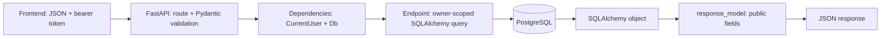

# Backend guide

Most new features follow the same path: **add a database model, define request and
response schemas, add a router, migrate the database, then test ownership**. The
Notes walkthrough below is a copyable example for your first private CRUD
feature. It is documentation only; Notes endpoints are not installed yet.

## What each part does

| File / tool | Responsibility |
| --- | --- |
| `main.py` | Creates FastAPI, configures CORS, and registers routers. |
| `routes/auth.py` | Signup, login, current-account, and logout HTTP endpoints. |
| `routes/<feature>.py` | Your future endpoints, grouped by feature. |
| `auth.py` | Password/token helpers and the reusable `CurrentUser` dependency. |
| `database.py` | SQLAlchemy engine, model `Base`, and the request-scoped `Db` dependency. |
| `models.py` | SQLAlchemy classes describing database tables and constraints. |
| `schemas.py` | Pydantic classes describing accepted inputs and public outputs. |
| `config.py` | Settings loaded from environment variables / `.env`. |
| `migrations/` | Alembic's versioned database changes. |
| `tests/` | API and database behavior checks. |
| PostgreSQL | Stores accounts, login sessions, and your future user data. |
| Docker Compose | Runs PostgreSQL, applies migrations, and starts the API. |

Keep the layout small. Use ordinary `def` endpoints with this synchronous
SQLAlchemy setup. Put straightforward queries directly in the feature router;
extract a helper when several endpoints share a check. Add a separate business
logic module when real workflows become complex enough to need it.

## How one request works



This is a conceptual flow; FastAPI resolves validation and dependencies before
running your endpoint. For example:

```python
def create_note(payload: NoteCreate, user: CurrentUser, db: Db):
    ...
```

You do not call `CurrentUser` or open the database manually. FastAPI supplies the
validated body, authenticated `User`, and database `Session`. `CurrentUser`
raises `401` when credentials are missing or invalid. See [FastAPI's dependency
example](https://fastapi.tiangolo.com/tutorial/security/get-current-user/).

There are two different kinds of "model":

- A **SQLAlchemy model** defines storage: table, columns, foreign keys, indexes.
- A **Pydantic schema** defines an API contract: accepted fields, validation,
  defaults, and public response fields. Changing a schema alone does not change
  the database.

Returning a SQLAlchemy object is fine when you declare a response schema with
`from_attributes=True`. FastAPI's `response_model` validates and filters the
output. This is how `UserResponse` includes an email but excludes
`password_hash`. See [response models](https://fastapi.tiangolo.com/tutorial/response-model/).

## How accounts stay private

1. **Signup:** validate the email/password, hash the password with Argon2, and
   save a `User`. The response contains public account fields. Signup does not
   automatically sign the user in.
2. **Login:** verify the password, generate a random bearer token, and save an
   `AuthSession` containing its SHA-256 digest, the user ID, and an expiry.
   Return the original token to the caller.
3. **Authenticated request:** the caller sends
   `Authorization: Bearer <token>`. `CurrentUser` hashes that token, finds an
   unexpired login session, and loads its user. The default expiry is 24 hours.
4. **Logout:** delete that login session. Its token stops working immediately;
   other login sessions remain valid.

The token is a random credential checked against the database. Anyone holding
it can use that login, so never put tokens or passwords in URLs or logs. The
frontend currently keeps the token in memory; a page reload requires login.

**Authentication** answers "Who is making this request?" `CurrentUser` handles
that. **Authorization** answers "Can that user access this record?" Your query
must handle that with `Record.user_id == user.id`. Protecting a frontend page
alone does not protect its API.

Also distinguish these similarly named classes:

| Name | Meaning | Lifetime |
| --- | --- | --- |
| SQLAlchemy `Session` / `Db` | Database work and transaction state for a request. | Closed when the request finishes. |
| `AuthSession` | A database row representing a user's login. | Valid until logout or expiry; expired rows may remain until cleanup. |

Closing `Db` does not sign a user out. Deleting `AuthSession` does not close the
database connection pool.

For account profile/settings endpoints, `CurrentUser` is already the current
SQLAlchemy `User` object. Define a dedicated `UserUpdate` schema listing only
editable profile fields and update that object. Never accept `id`,
`password_hash`, or `created_at` in a generic profile update. Email and password
changes deserve separate endpoints with appropriate identity verification and
session handling.

## Your usual development loop

1. Decide the record's fields and who owns it.
2. Add the SQLAlchemy model and database constraints.
3. Add separate create, update, and response schemas.
4. Add endpoints using `CurrentUser` and `Db`; scope every query by owner.
5. Register the router in `main.py`.
6. Generate, review, and apply an Alembic migration.
7. Try the endpoints in [Swagger](http://localhost:8000/docs), then write tests
   for successful behavior, validation, and access by another user.
8. Call the endpoints from the frontend and handle error responses.

## Walkthrough: private Notes CRUD

CRUD means create, read, update, and delete. In this example, each note belongs
to exactly one user. The client may edit a title and content, but cannot choose
or change ownership.

### 1. Add the table to `models.py`

Append the class below to `models.py`, merging these imports into the existing
imports:

```python
from uuid import UUID, uuid4

from sqlalchemy import ForeignKey, String, Text, Uuid
from sqlalchemy.orm import Mapped, mapped_column

from database import Base


class Note(Base):
    __tablename__ = "notes"

    id: Mapped[UUID] = mapped_column(Uuid, primary_key=True, default=uuid4)
    user_id: Mapped[UUID] = mapped_column(
        ForeignKey("users.id", ondelete="CASCADE"), nullable=False, index=True
    )
    title: Mapped[str] = mapped_column(String(120), nullable=False)
    content: Mapped[str] = mapped_column(Text, default="", nullable=False)
```

`user_id` links the note to `users.id`. PostgreSQL rejects nonexistent owners;
`CASCADE` removes their notes if an account is deleted. The index helps queries
that filter by owner. A UUID makes a convenient record ID, but ownership checks
are still required.

### 2. Add schemas to `schemas.py`

Append these schemas to `schemas.py`. These imports are already present:

```python
from uuid import UUID

from pydantic import BaseModel, ConfigDict, Field, field_validator


class NoteCreate(BaseModel):
    model_config = ConfigDict(extra="forbid")

    title: str = Field(min_length=1, max_length=120)
    content: str = Field(default="", max_length=10_000)


class NoteUpdate(BaseModel):
    model_config = ConfigDict(extra="forbid")

    title: str | None = Field(default=None, min_length=1, max_length=120)
    content: str | None = Field(default=None, max_length=10_000)

    @field_validator("title", "content")
    @classmethod
    def reject_explicit_null(cls, value: str | None) -> str:
        # Validators do not run for these omitted defaults.
        if value is None:
            raise ValueError("Omit the field to leave it unchanged; null is not allowed")
        return value


class NoteResponse(BaseModel):
    model_config = ConfigDict(from_attributes=True)

    id: UUID
    title: str
    content: str
```

`extra="forbid"` rejects unexpected fields, including a caller-supplied
`user_id` or `id`. The route decides ownership. The response deliberately
contains only the fields the UI needs.

PATCH distinguishes an omitted field from an explicit value:

| PATCH body | Effect |
| --- | --- |
| `{"title": "New title"}` | Update title; leave content unchanged. |
| `{"content": ""}` | Clear content to an empty string. |
| `{}` | Leave the note unchanged. |
| `{"title": null}` or `{"content": null}` | Reject with 422; these columns cannot be null. |
| `{"title": ""}` | Reject with 422. |
| `{"user_id": "someone-else"}` | Reject with 422. |

`model_dump(exclude_unset=True)` produces only fields actually supplied by the
caller. Without it, omitted update defaults could overwrite stored data. See
[FastAPI's partial update guide](https://fastapi.tiangolo.com/tutorial/body-updates/)
and [Pydantic serialization](https://docs.pydantic.dev/latest/concepts/serialization/).

### 3. Create `routes/notes.py`

```python
from typing import Annotated
from uuid import UUID

from fastapi import APIRouter, HTTPException, Query, Response, status
from sqlalchemy import select
from sqlalchemy.orm import Session

from auth import CurrentUser
from database import Db
from models import Note
from schemas import NoteCreate, NoteResponse, NoteUpdate

router = APIRouter(prefix="/api/v1/notes", tags=["notes"])


def load_owned_note(note_id: UUID, user_id: UUID, db: Session) -> Note:
    note = db.scalar(
        select(Note).where(Note.id == note_id, Note.user_id == user_id)
    )
    if note is None:
        # Same response for an unknown note and another user's note.
        raise HTTPException(status_code=404, detail="Note not found")
    return note


@router.post("", response_model=NoteResponse, status_code=status.HTTP_201_CREATED)
def create_note(payload: NoteCreate, user: CurrentUser, db: Db) -> Note:
    note = Note(user_id=user.id, **payload.model_dump())
    db.add(note)
    db.commit()
    db.refresh(note)
    return note


@router.get("", response_model=list[NoteResponse])
def list_notes(
    user: CurrentUser,
    db: Db,
    limit: Annotated[int, Query(ge=1, le=100)] = 20,
    offset: Annotated[int, Query(ge=0)] = 0,
) -> list[Note]:
    return list(db.scalars(
        select(Note)
        .where(Note.user_id == user.id)
        .order_by(Note.id)
        .offset(offset)
        .limit(limit)
    ))


@router.get("/{note_id}", response_model=NoteResponse)
def get_note(note_id: UUID, user: CurrentUser, db: Db) -> Note:
    return load_owned_note(note_id, user.id, db)


@router.patch("/{note_id}", response_model=NoteResponse)
def update_note(
    note_id: UUID, payload: NoteUpdate, user: CurrentUser, db: Db
) -> Note:
    note = load_owned_note(note_id, user.id, db)
    for field, value in payload.model_dump(exclude_unset=True).items():
        setattr(note, field, value)
    db.commit()
    db.refresh(note)
    return note


@router.delete("/{note_id}", status_code=status.HTTP_204_NO_CONTENT)
def delete_note(note_id: UUID, user: CurrentUser, db: Db) -> Response:
    note = load_owned_note(note_id, user.id, db)
    db.delete(note)
    db.commit()
    return Response(status_code=status.HTTP_204_NO_CONTENT)
```

The ownership rule appears in creation, the list query, and the shared lookup
for single-record operations. `db.get(Note, note_id)` alone would not check the
owner. Use the authenticated user for every lookup of a private record,
including parent records referenced when creating related data.

List pagination is bounded so one request cannot load every row. The explicit
ordering makes pages predictable for a fixed dataset; UUID ordering does not
mean creation order. Add a timestamp if you need newest-first sorting. Offset
pagination is enough to start; growing datasets may eventually need cursor
pagination.

### 4. Register the router in `main.py`

Keep the existing app setup and auth router. Add:

```python
from routes.notes import router as notes_router

app.include_router(notes_router)
```

The backend already allows the frontend development origins and CRUD methods
through CORS. CORS controls browser cross-origin requests; it does not grant
access to private data.

### 5. Generate and apply the migration

Start the development database from the repository root, then run Alembic from
`backend/`. These commands assume local Python 3.12+ and `uv`:

```sh
docker compose up db -d
cd backend
uv sync --group dev
uv run alembic upgrade head
uv run alembic revision --autogenerate -m "add notes table"
# Open the new file in migrations/versions/ and review upgrade()/downgrade().
uv run alembic upgrade head
uv run uvicorn main:app --reload
```

Autogeneration compares imported SQLAlchemy metadata with the current database
and creates a proposed migration. Review its table, nullability, foreign key,
and index changes before applying it; some changes, including renames, need
manual editing. Keep migrations in Git. See [Alembic's autogeneration guide](https://alembic.sqlalchemy.org/en/latest/autogenerate.html).

Changing a Python model does not update an existing PostgreSQL table. Use
Alembic for schema changes instead of calling `Base.metadata.create_all()` at
production startup. If running the app in Docker, rebuild/restart it after code
changes with `docker compose up --build -d` from the repository root; the
migration service applies the migration files included in the image.

### 6. Call it from the frontend

Use the token returned by login. For example, inside code that already has
access to that token:

```typescript
const apiUrl = import.meta.env.VITE_API_URL ?? "http://localhost:8000";
const response = await fetch(`${apiUrl}/api/v1/notes`, {
  method: "POST",
  headers: {
    "Content-Type": "application/json",
    Authorization: `Bearer ${token}`,
  },
  body: JSON.stringify({ title: "First note", content: "My private content" }),
});

if (!response.ok) {
  throw new Error(`Creating the note failed (${response.status})`);
}
const note = await response.json();
```

Use the same Authorization header for listing, reading, updating, and deleting.
For DELETE, a successful `204` has no JSON body. Your UI should return users to
login on `401` and display validation feedback on `422`.

The current frontend's `AuthProvider` keeps the token inside its private
`session` state. When wiring data pages, add a shared authenticated request
function there, using `session.token`, and expose that function through
`useAuth`. The `token` variable above represents that session value; it is not
currently exported to page components.

## Database writes: add, commit, refresh, rollback

- `db.add(object)` marks a new object for insertion.
- Changing a loaded object's fields marks it for updating.
- `db.delete(object)` marks it for deletion.
- `db.commit()` flushes pending SQL and commits the transaction. Commit once
  after a complete operation; related writes can share one transaction.
- `db.refresh(object)` reloads database values after saving, useful for generated
  IDs and defaults.
- `db.rollback()` discards an unsuccessful transaction. If you catch a database
  error and continue using that session, explicitly roll it back first.

The `get_db` dependency closes the session after the request, releasing its
connection and rolling back any still-uncommitted transaction. An unexpected
database exception can propagate as a server error and the session is cleaned
up. For an expected conflict, catch the specific exception, roll back, and
return a useful status. The existing signup route demonstrates this for a
duplicate email. Never return raw database exception text to the client. See
[SQLAlchemy session basics](https://docs.sqlalchemy.org/en/20/orm/session_basics.html).

## Checks to repeat for each private feature

Use two test users, Alice and Bob, with different login tokens. Follow the
dependency overrides and isolated database setup already in `tests/`.

- Alice can create, list, read, update, and delete her own record.
- Bob's list never contains Alice's records, including across pagination.
- Bob gets `404` when reading, updating, or deleting Alice's record; Alice's
  data remains unchanged.
- Missing, invalid, expired, and logged-out tokens return `401`.
- Invalid UUIDs, missing/oversized fields, forbidden owner fields, explicit
  nulls, and invalid pagination return `422`.
- PATCH changes only supplied fields; an empty content string clears content.
- Pagination respects limit/offset and applies ownership before pagination.
- DELETE returns `204` without a body; reading the deleted record returns `404`.

Run tests with `uv run pytest -q` from `backend/`. SQLite tests are convenient,
but use a disposable PostgreSQL test database for migrations and behavior
specific to PostgreSQL; never point tests at real user data. The root README
documents `TEST_DATABASE_URL`.

## Habits to keep

Treat the backend as the source of truth for identity and ownership. Keep
request schemas limited to editable fields, use response schemas for public
fields, enforce constraints in PostgreSQL, and use SQLAlchemy expressions
instead of building SQL strings from input. Add an index for frequently used
filters and paginate lists. Keep secrets in environment variables and out of
Git. Back up real data before applying potentially destructive migrations.

Use these status codes consistently:

| Status | Typical meaning here |
| --- | --- |
| `200` | Successful read or update. |
| `201` | Created a resource. |
| `204` | Successful delete/logout, with no response body. |
| `401` | Login is required or credentials no longer work. |
| `403` | Authenticated, but lacks permission for an explicitly restricted action. |
| `404` | Record does not exist or is not owned by the caller. |
| `409` | Conflict with a unique constraint, such as an existing email. |
| `422` | Request validation failed. |

This starter is ready for local feature development. Before serving real
accounts, add HTTPS, login throttling, password recovery, email verification,
and deployment-specific secret/backup configuration.
